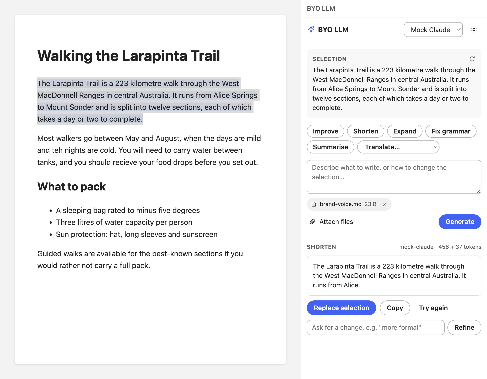
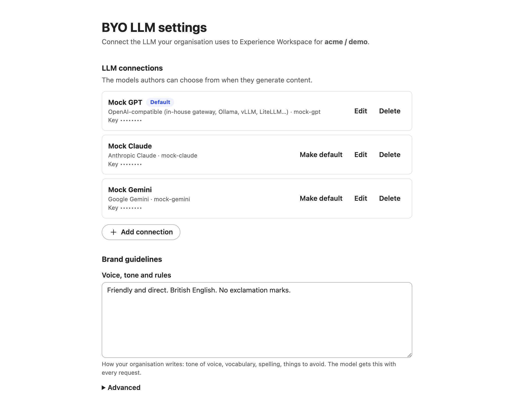

# BYO LLM for Experience Workspace

A plugin for [Adobe Experience Workspace](https://da.live) (DA) that lets authors write
and rewrite page content with the LLM their organisation already uses: OpenAI, Azure
OpenAI, Anthropic Claude, Google Gemini, or any OpenAI-compatible endpoint such as an
in-house gateway or a local model.

Authors select content in the editor, pick a quick action or describe what they want,
optionally attach files for context, check the result and put it into the page. A site
admin connects the models and sets brand guidelines once per site.



*The panel in the local development host (`npm run dev`), with a mock model.*

This README is for the person who sets the plugin up. For how to use it, see the
[author guide](guides/authors.md).

## What it does

- **Works on the selection.** Improve, Shorten, Expand, Fix grammar, Summarise and
  Translate rewrite what is selected. A free-text instruction does anything else. With
  nothing selected, the result is inserted at the cursor.
- **Attachments as context.** Text files (txt, md, csv, json, html and similar), images
  (png, jpg, webp, gif) and PDFs. Up to 5 files per request.
- **Any LLM.** Several connections per site; authors choose in the panel.
- **Brand guidelines.** One text per site, sent to the model with every request.
- **Preview first.** Nothing changes in the document until the author chooses Replace
  selection or Insert at cursor. Authors can ask for a change ("more formal") or retry.
- **Settings UI.** Connections, API keys and guidelines are managed in the panel (gear
  icon) or in a fullscreen settings app, and saved in the site's `/.da` folder.

The plugin is plain HTML, CSS and JavaScript modules. It has no build step and loads
nothing from other hosts: no framework, no CDN script, no hosted SDK.

## Before you start

- **A site in Experience Workspace** and permission to edit its configuration.
- **An LLM endpoint and API key.** See [Providers](#providers).
- **A public GitHub repository** for this code, with
  [AEM Code Sync](https://github.com/apps/aem-code-sync/installations/new) installed.
  Experience Workspace loads plugins from `https://main--{repo}--{owner}.aem.live`.

## Set it up

### 1. Publish the code

1. Push this project to a public GitHub repository, for example `{owner}/ew-byo-llm`.
2. Install [AEM Code Sync](https://github.com/apps/aem-code-sync/installations/new) on
   that repository.
3. Check that
   `https://main--{repo}--{owner}.aem.live/plugin/tools/byo-llm/byo-llm.html` loads. Opened
   directly it says "Connecting to Experience Workspace…" and, after a few seconds, that
   it has to be opened from the editor. That is expected.

Only `plugin/tools/` is served. `.hlxignore` keeps everything else off the CDN.

### 2. Add the plugin to a site

1. Open the site configuration: `https://da.live/config#/{org}/{site}/`.
2. In the `library` sheet (add a tab called `library` if there is none), add a row:

   | title | path | icon |
   |---|---|---|
   | BYO LLM | `https://main--{repo}--{owner}.aem.live/plugin/tools/byo-llm/byo-llm.html` | `https://main--{repo}--{owner}.aem.live/plugin/tools/byo-llm/icon.svg` |

   Leave `ref`, `experience` and `format` empty. The plugin opens as a side panel.
3. Save the configuration.
4. Open a page of the site in the editor. "BYO LLM" is in the library.

### 3. Connect your LLM

1. In the panel, choose **Open settings** (or the gear icon).
2. Choose **Add connection** and fill in the name authors will see, the provider, the
   endpoint URL, the model and the API key.
3. Choose **Test connection**. The plugin sends a one-line request and reports whether
   the model answered.
4. Choose **Save connection**. Add more connections if authors should have a choice; the
   one marked Default is preselected.
5. Optional: enter your **brand guidelines** and choose **Save**.

The settings are written to the sheet `/{org}/{site}/.da/byo-llm`. See
[Where the credentials are stored](#where-the-credentials-are-stored).



### 4. Optional: the settings app

The same settings UI is available as a fullscreen app, for admins who prefer not to open
a page first:

```
https://da.live/app/{owner}/{repo}/plugin/tools/byo-llm/config#/{org}/{site}
```

`{owner}/{repo}` is the GitHub repository of the plugin. `#/{org}/{site}` is the site to
configure; without it the app would configure the plugin repository itself. Experience
Workspace may ask you to trust the app the first time.

To list it among the site's apps, add a row to the `apps` sheet of the site
configuration with a `title`, a `description` and that URL as `path`.

### 5. Check the permissions

The plugin reads and writes the settings with the signed-in user's own Experience
Workspace permissions. There is no separate access control.

- **Authors need `read`** access to `/{site}/.da/byo-llm.json`. Authors who can read the
  site's content already have it.
- **Whoever may change the settings needs `write`** access to that file. By default this
  is everyone who can edit the site's content. To limit it to admins, add rows to the
  `permissions` sheet of the organisation configuration
  (`https://da.live/config#/{org}/`), for example:

  | path | groups | actions |
  |---|---|---|
  | `/{site}/.da/**` | `{ims-org-id}/authors` | `read` |
  | `/{site}/.da/**` | `{ims-org-id}/admins` | `write` |

  See [Permissions and security](https://www.aem.live/docs/ew/administering/permissions)
  for groups and path rules. Authors without write access see the settings read-only.

## Providers

| Provider | Endpoint URL | Model field | Images | PDF |
|---|---|---|---|---|
| OpenAI | `https://api.openai.com/v1` (prefilled) | Model name, e.g. `gpt-4o` | yes | yes |
| Azure OpenAI | `https://{resource}.openai.azure.com` | Your deployment name | yes | no |
| Anthropic Claude | `https://api.anthropic.com` (prefilled) | Model name | yes | yes |
| Google Gemini | `https://generativelanguage.googleapis.com/v1beta` (prefilled) | Model name, e.g. `gemini-2.5-flash` | yes | yes |
| OpenAI-compatible | Your endpoint, e.g. `https://llm.example.com/v1` | The name your endpoint expects | yes | no |

Notes:

- **OpenAI-compatible** covers gateways and servers that implement
  `POST {endpoint}/chat/completions`: LiteLLM, vLLM, Ollama, LM Studio, OpenRouter and
  most in-house gateways. The API key is optional. If your gateway expects the key in
  another header, enter the header name in **API key header**.
- **Azure OpenAI** uses API version `2024-10-21` unless you enter another. You can also
  paste the full URL from the Azure portal.
- **A model on the author's own machine** (`http://localhost…`) is allowed. Every other
  endpoint must be `https`.
- Whether a model can actually read images or PDFs depends on the model. The table says
  what the provider's API accepts.
- By default **the author's browser calls the LLM directly**, so the endpoint must accept
  cross-origin requests (CORS). The public APIs of OpenAI, Anthropic and Gemini do. If
  yours does not, or it is only reachable from allow-listed addresses, use the
  [proxy](#optional-the-proxy).

## Where the credentials are stored

Experience Workspace has no secrets API for plugins. Integrations keep their credentials
in the site's hidden `/.da` folder, and this plugin does the same.

- The settings are one sheet: `/{org}/{site}/.da/byo-llm`
  (`https://da.live/sheet#/{org}/{site}/.da/byo-llm`).
- The connections, including API keys, are in the tab `private-connections`. Brand
  guidelines, the default connection and the proxy URL are in `private-settings`.
  Experience Workspace leaves tabs whose name starts with `private-` out of preview and
  publish, so they never reach the public site. The only public tab, `info`, holds a note.
- **Do not rename those tabs**, and do not preview or publish the sheet.

What this does and does not protect:

- **Anyone who can read the sheet can read the API keys**, and authors must be able to
  read it. The panel masks keys, but the sheet shows them. Treat every author as someone
  who has the key.
- Use a key made for this purpose, with a spending limit and only the models authors need.
  A gateway that issues such keys is a good fit for the OpenAI-compatible provider.
- Limit who can write to `/.da` (see [permissions](#5-check-the-permissions)): someone who
  can edit the sheet can point requests at another endpoint.

## What data goes where

- **To the LLM endpoint:** the instruction, the selected content as HTML, the attached
  files, the brand guidelines and the API key. In the default setup this goes straight
  from the author's browser to the endpoint.
- **To Adobe's APIs** (`admin.da.live`, `admin.hlx.page`, `api.aem.live`): reading and
  saving the settings sheet, with the author's Experience Workspace sign-in.
- **Attachments** are read in the browser and exist only inside the request. They are
  not uploaded to Experience Workspace and not stored.
- **In the browser:** the name of the connection the author used last, in local storage.
  No key, no content.
- **Nowhere else.** There is no telemetry and no third-party script.

The model's answer is treated as untrusted. Before it is shown or inserted it is reduced
to plain content markup (paragraphs, headings, lists, tables, links, emphasis). Scripts,
styles, event handlers, forms and unsafe links are removed, and images are kept only if
they were already in the selection.

## Optional: the proxy

`proxy/` contains an [Adobe App Builder](https://developer.adobe.com/app-builder/)
web action that calls the LLM instead of the browser. Use it when the endpoint does not
accept browser requests or only accepts allow-listed addresses.

How it works: the plugin sends the request and the author's Experience Workspace token
to the action. The action uses that token to read the site's settings sheet from DA, so
it only serves people who can read the sheet, then calls the LLM with the stored
connection. It keeps no state and has no dependencies.

The proxy is about reachability, not secrecy. Authors can still read the sheet, so it
does not hide the API key from them.

Deploy:

```sh
cd proxy
aio login
aio app use            # choose your App Builder project and workspace; writes .env
echo 'BYO_LLM_ALLOWED_ORGS=my-da-org' >> .env
aio app deploy
```

- `BYO_LLM_ALLOWED_ORGS` is required: the DA organisations this proxy serves,
  comma-separated. An entry is an organisation (`my-org`) or one site (`my-org/my-site`).
  The action refuses everything else, and refuses everything if the list is empty.
- `aio app deploy` prints the action URL
  (`https://{namespace}.adobeioruntime.net/api/v1/web/byo-llm/generate`). Enter it in the
  plugin settings under **Advanced > Proxy URL** and save. All connections of the site
  then go through the proxy, and **Test connection** becomes **Save and test**.
- The action only calls `https` endpoints on the public internet, and does not follow
  redirects.
- Requests through the proxy are limited to about 1 MB (an I/O Runtime limit), which
  mostly affects image and PDF attachments, and to 60 seconds.
- Never commit `.env` or `.aio`. `.gitignore` excludes them.

## Limits

- No streaming: the answer appears when the model has finished.
- One request at a time per panel. A request can be cancelled.
- The selection can be up to 100,000 characters of HTML. Text attachments are limited to
  1 MB and cut after 200,000 characters; images to 20 MB (large images are scaled down
  before sending); PDFs to 10 MB.
- The editor reports part of a paragraph the same way as a whole paragraph. To keep a
  partly selected paragraph in one piece, the plugin inserts a plain one-paragraph answer
  as text. If that answer contains formatting (bold, links), it is inserted as a block
  and splits the paragraph.
- Blocks (the tables that Edge Delivery turns into components) come back as tables. The
  model is told to keep the structure, but check the result.
- The settings sheet holds one configuration per site, not per organisation.

## What has been tested

Tested locally, against the mock host and mock services in `dev/`:

- The whole author flow: quick actions, free-text instructions, attachments, refine,
  retry, cancel, replace and insert.
- The settings UI: add, edit, test, delete, default, brand guidelines, proxy URL,
  read-only and no-access states, and the fullscreen app.
- Request and response handling for all five providers, the settings store, the
  sanitizer and the proxy action, in the unit tests (`npm test`).
- The built proxy action (`aio app build`) loads and answers.
- Against the live APIs of OpenAI, Anthropic and Gemini with an invalid key: the request
  reaches the right endpoint, is rejected as expected, and the browser preflight (CORS)
  passes.

Not yet tested, because it needs your accounts:

- **The plugin inside the real Experience Workspace editor.** The local host follows
  da.live's messaging protocol and insertion rules, but it is a stand-in.
- **A real answer from a real model**, and Azure OpenAI in any form.
- **Saving the settings to a real DA site**, including sites on the new AEM API
  ("Helix 6"), for which the code has a separate path.
- **A deployed proxy action.**

## Develop

```sh
npm install
npm test          # plugin and proxy tests (npm run test:plugin, npm run test:proxy)
npm run dev
```

`npm run dev` starts a local server on <http://localhost:3000> with a stand-in for the
editor, a fake DA and fake OpenAI, Anthropic and Gemini endpoints. Nothing leaves your
machine and no real key is needed.

- **Seed mock connections** adds three working connections. To add one by hand, use
  provider OpenAI-compatible, endpoint `http://localhost:3000/mock/openai/v1`, any model
  name and the API key `mock-key`.
- The **Org** menu switches between an admin, an author who cannot edit the settings and
  a user with no access.
- Model names choose the mock's behaviour: a name containing `slow` takes 6 seconds,
  `error` returns a rate-limit error, `markdown` answers in Markdown, `unsafe` answers
  with script tags and unsafe links.
- To try the proxy locally, set the proxy URL to
  `http://localhost:3000/mock/proxy/generate`. It runs the real action code against the
  mocks.

To try your local copy in the real editor, add a library row with path
`/plugin/tools/byo-llm/byo-llm.html` and ref `local`, run `npm run dev`, and open the editor with
`?ref=local`. Experience Workspace loads paths that start with `/` from
`http://localhost:3000` for `local` rows.

Layout:

| Path | Contents |
|---|---|
| `plugin/tools/byo-llm/` | The plugin: the panel (`byo-llm.html`), the fullscreen settings app (`config.html`) and `lib/`. Plain ES modules, no build step. This is all that is served. |
| `plugin/test/` | Unit tests of the plugin. |
| `proxy/` | The optional App Builder app: the `byo-llm/generate` action, its helpers in `lib/` and its tests. It shares the provider and settings code in `plugin/tools/byo-llm/lib/`. |
| `dev/` | Local Experience Workspace host and mock DA, OpenAI, Anthropic and Gemini. |
| `guides/` | The author guide and the screenshots. |
| `marketplace/row.json` | Values for a marketplace listing. |

## Marketplace

The [Experience Workspace marketplace](https://da.live/marketplace) lists extensions with
a short description and a link to their docs. A listing installs nothing; each site still
needs the library row above.

`marketplace/row.json` has the values for a listing. It has no card image yet.

## Background and license

The plugin brings the ideas of an earlier set of App Builder extensions for AEM (a BYO
LLM configuration UI with brand guidelines, and actions that proxy requests to OpenAI) to
Experience Workspace, as one self-contained project. `plugin/tools/byo-llm/lib/da-sdk.js` is an
independent implementation of the Experience Workspace App SDK protocol, written after
Adobe's hosted SDK ([adobe/da-nx](https://github.com/adobe/da-nx), Apache-2.0).

Apache-2.0, see [LICENSE](LICENSE). OpenAI, Azure, Anthropic, Claude and Gemini are
trademarks of their owners. This plugin is not made or endorsed by them.
